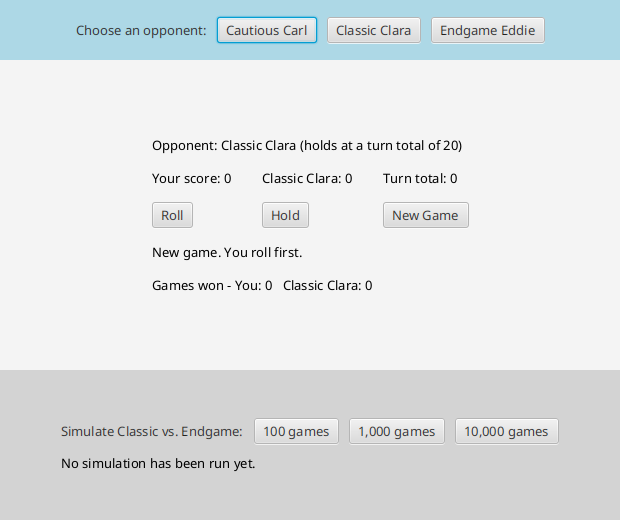
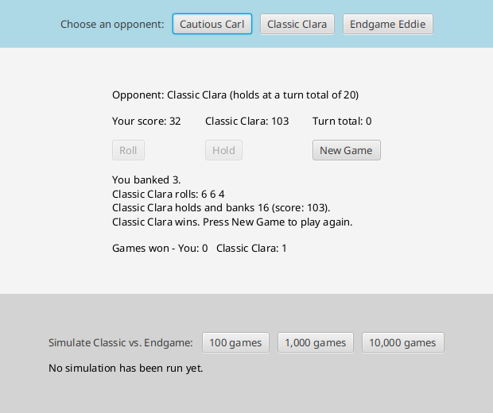

# Dice Duel

A two-player dice game written in Java (the rules are those of the
traditional dice game Pig), with three computer opponents,
a strategy simulator, a text version and a JavaFX version.

This is a personal project.

Written by me; AI used for review and debugging.





## Rules

On your turn you roll one die as many times as you like. Each roll of 2 to 6
is added to your turn total. Rolling a 1 wipes out the turn total and ends
your turn. Holding banks the turn total and ends your turn. The first player
to bank 100 points wins.

## Computer opponents

You play against one of three computer players:

- **Cautious Carl** is a `ThresholdBot` that holds once its turn total reaches 15.
- **Classic Clara** is a `ThresholdBot` that holds once its turn total reaches 20.
- **Endgame Eddie** is an `EndgameBot` that holds at 20, but keeps rolling when the opponent is within 25 points of winning (unless holding would already win).

A `ThresholdBot` also holds as soon as its banked score plus the turn total
reaches 100, so it does not take an unnecessary risk when it can already win.

## Classes

| Class | Purpose |
|---|---|
| `Die` | A die that can be rolled |
| `Player` | A player's name, score and number of wins |
| `ComputerPlayer` | Abstract subclass of `Player`; every computer player must supply a strategy |
| `ThresholdBot` | Holds once its turn total reaches a set number |
| `EndgameBot` | A `ThresholdBot` that keeps rolling when the opponent is close to winning |
| `DiceDuelGame` | The rules: whose turn it is, the turn total, rolling, holding, winning |
| `Simulator` | Plays many games between two computer players and reports win percentages |
| `SimulatorDriver` | Runs four strategy matchups from the terminal |
| `DiceDuelConsole` | Text version of the game |
| `DiceDuelApp` | JavaFX version of the game |

Relationships:

- `ComputerPlayer` is a `Player`; `ThresholdBot` is a `ComputerPlayer`;
  `EndgameBot` is a `ThresholdBot`.
- `DiceDuelGame` has a `Die` and two `Player` objects.
- `Simulator` has two `ComputerPlayer` objects.

## How to run

You need a JDK. I compiled and ran this with Temurin 21. For the JavaFX
version you also need the [JavaFX SDK](https://openjfx.io/) (the `lib`
folder inside the SDK is the module path in the commands below).

Open a terminal in the `src` folder.

Text version and simulator:

```
javac *.java        (leave out DiceDuelApp.java if JavaFX is not installed)
java DiceDuelConsole
java SimulatorDriver
```

JavaFX version:

```
javac --module-path "path to your javafx lib folder" --add-modules javafx.controls DiceDuelApp.java
java --module-path "path to your javafx lib folder" --add-modules javafx.controls DiceDuelApp
```

The text version accepts `r` or `R` to roll, `h` or `H` to hold, and `y` or
`Y` to play again. If you type something other than 1, 2 or 3 when choosing
an opponent, it asks you to try again.

`SimulatorDriver` asks you to choose 1, 2 or 3 for 1,000, 10,000 or 100,000
games per matchup. Typing something else (including letters) prompts you to
try again.

The JavaFX window lets you pick an opponent, play with Roll and Hold, start a
new game (you and the computer take turns rolling first), and run 100, 1,000
or 10,000 simulated games of Classic (hold at 20) versus Endgame. Roll and
Hold are disabled once someone wins; press New Game to play again.

## Strategy results

I ran `java SimulatorDriver` from the `src` folder (after compiling) and
chose option 2 (10,000 games per matchup). One run produced:

**Matchup 1** — is holding at 20 better than holding at 15?

- Games played: 10000
- Hold at 15 won 45.0%
- Hold at 20 won 55.0%
- The player who rolled first won 53.1%

**Matchup 2** — is holding at 20 better than holding at 25?

- Games played: 10000
- Hold at 25 won 50.9%
- Hold at 20 won 49.1%
- The player who rolled first won 54.1%

**Matchup 3** — does paying attention to the opponent help?

- Games played: 10000
- Hold at 20 won 46.5%
- Endgame won 53.5%
- The player who rolled first won 52.9%

**Matchup 4** — two identical hold-at-20 bots, to measure the advantage of rolling first.

- Games played: 10000
- Hold at 20 (A) won 50.4%
- Hold at 20 (B) won 49.6%
- The player who rolled first won 53.6%

Holding at 20 clearly beats 15; 20 vs 25 is too close to call over 10,000 games; watching the opponent's score helped (53.5% vs 46.5%).

These numbers will change a little each time you run the simulator, because
the dice are random.

## Known limitations

- The computer's turn is shown all at once rather than one roll at a time.
- Results are not saved between runs.

## Licence

MIT — see [LICENSE](LICENSE).
